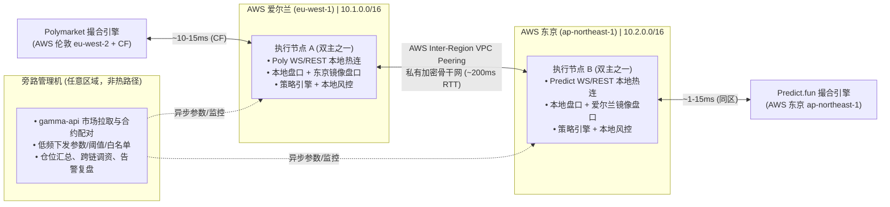
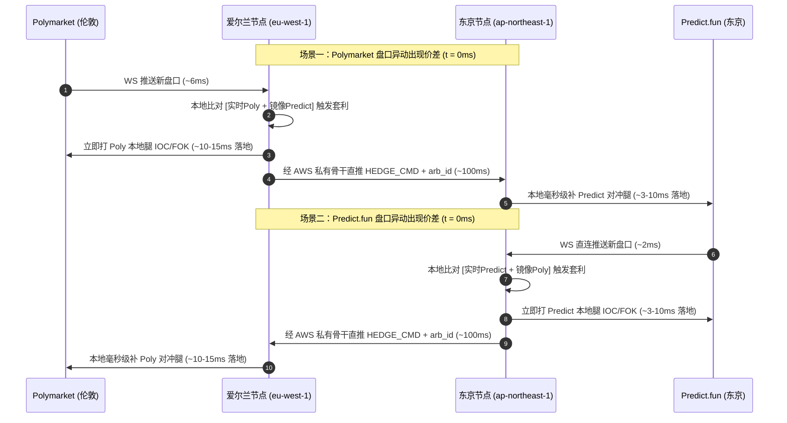

# Polymarket × Predict.fun 跨所套利部署方案（双主对称架构）

> **核心架构原则**：**AWS 爱尔兰 (`eu-west-1`) + AWS 东京 (`ap-northeast-1`) 双主对称部署，通过 AWS 私有骨干网直连，不设第三地实时决策中心。** 任何放在两地中间的实时分析节点都会增加一跳跨洲传输，把本地腿延迟从 3–15ms 拖慢到 110ms+。

---

## 1. 目标平台机房与合规现状

| 平台 | 业务接口 | 接入层 | 真实撮合源站 | 地理合规红线 |
| :--- | :--- | :--- | :--- | :--- |
| **Polymarket** | `https://clob.polymarket.com`<br>`wss://ws-subscriptions-clob.polymarket.com/ws/market` | Cloudflare (Argo) | **AWS 伦敦 (`eu-west-2`)** | **英/美/德/新/泰** API 封禁（Close-Only，无法开新单）；**爱尔兰、荷兰、日本、香港**允许 API 下单 |
| **Polymarket** | `https://gamma-api.polymarket.com` | AWS CloudFront | 欧美（仅市场元数据，放旁路） | — |
| **Predict.fun** | `wss://ws.predict.fun/ws` | **无 CDN，直连 AWS ELB** | **AWS 东京 (`ap-northeast-1`)** | 限制美国及受制裁地区；官方建议部署于 AWS 东京 |
| **Predict.fun** | `https://api.predict.fun/v1` | Cloudflare | **AWS 东京 (`ap-northeast-1`)** | 同上 |

**选址结论**：
- **欧洲主节点**：**AWS 爱尔兰 (`eu-west-1`)** —— 避开英国伦敦地理封禁，同时距伦敦撮合引擎仅 **~10–15ms**。
- **亚洲主节点**：**AWS 东京 (`ap-northeast-1`)** —— 与 Predict.fun **完全同区**，WS 直连仅 **~1–3ms**，REST 走本地 Cloudflare (`-NRT`) 仅 **~5–20ms**。

---

## 2. 双主对称系统拓扑与抢单时序

### 2.1 网络与服务拓扑



### 2.2 抢单热路径时序（“谁本地异动，谁先打本地腿”）



---

## 3. 服务器采购清单

### 3.1 生产推荐版（高频抢单 / 延迟最稳）—— AWS EC2 + VPC Peering

| 节点角色 | AWS 区域 | 推荐机型 | 系统 | VPC 网段（**不可重叠**） | 公网 IP | 预估月成本 |
| :--- | :--- | :--- | :--- | :--- | :--- | :--- |
| **欧洲主节点 (Poly)** | `eu-west-1`（爱尔兰） | `c7i.large`（x86）或 `c7g.large`（ARM64，更省）<br>2 vCPU / 4GB RAM，计算型无 CPU 积分限制 | Ubuntu 24.04 LTS | `10.1.0.0/16` | 绑定 1 个 **EIP** | ~$60–$75 |
| **亚洲主节点 (Pred)** | `ap-northeast-1`（东京） | `c7i.large`（x86）或 `c7g.large`（ARM64）<br>2 vCPU / 4GB RAM，计算型无 CPU 积分限制 | Ubuntu 24.04 LTS | `10.2.0.0/16` | 绑定 1 个 **EIP** | ~$60–$75 |
| **跨区骨干互联** | 爱尔兰 ↔ 东京 | **Inter-Region VPC Peering** | — | 内网直连加密 | — | **0 小时费**，仅流量费 ~$2–$10 |
| **旁路机（可选）** | 香港 / 东京 / 任意 | 任意 2C4G 便宜机器（如 Lightsail $10 档） | Ubuntu 24.04 LTS | 独立 | 静态 IP | ~$10 |

> **切勿购买 Transit Gateway (TGW)**：两台机器互联用 **VPC Peering** 既免每月 ~$70+ 网关固定小时费，又少经过一跳转发，延迟更低。

### 3.2 低成本验证版（仅限前期联调/低频试跑）—— AWS Lightsail
若初期希望先压缩成本验证策略，可在 `eu-west-1` 和 `ap-northeast-1` 各买 1 台 **Lightsail（2 vCPU / 2GB RAM，$10–$12/月，自带 2TB+ 流量）** 并各绑定免费 **Static IP**：
- Lightsail **不支持**跨区私有内网 Peering，但两地用 Static IP 互连时**底层依然走 AWS 全球骨干网**（RTT 同为 ~200ms）；
- 需自行配置 **WireGuard 或 TLS 加密**，并在 Lightsail 防火墙仅放行对端 Static IP；
- **升级红线**：Lightsail 属于突发型 CPU（有积分耗尽降频风险）且网卡为共享低规格，正式高频抢单请切回 **EC2 计算型 (`c7i`/`c7g`)**。

> **采购避坑红线（实测排雷）**：
> 1. **严禁购买美国、英国、德国、新加坡、泰国节点**：这些地区 IP 会触发 Polymarket API Close-Only 封禁（注：部分商家标称“马来西亚新山”的新加坡线路实测 IP 归属仍为 `SG`，同样被封）。
> 2. **严禁购买 Cloudflare 绕路的小厂机器**：此前实测某些东京 BGP 商家虽然到 AWS 东京仅 2.4ms，但到 Cloudflare 边缘绕路高达 45–50ms，会导致 `api.predict.fun` 下单白白损失 50ms。

---

## 4. AWS 网络打通配置步骤（EC2 生产版）

1. **新建非重叠 VPC**：
   - 爱尔兰 (`eu-west-1`) 创建 VPC `10.1.0.0/16` + 公有子网（关联 IGW，分配 EIP）；
   - 东京 (`ap-northeast-1`) 创建 VPC `10.2.0.0/16` + 公有子网（关联 IGW，分配 EIP）；
   - *不要使用两地默认的 `172.31.0.0/16`，否则网段冲突无法 Peering。*
2. **建立跨区 VPC Peering**：
   - 在爱尔兰 VPC 控制台 → `Peering connections` → `Create peering connection`，选 `Another Region` → `ap-northeast-1`，填入东京 VPC ID；
   - 切换到东京控制台 → `Actions` → `Accept request`。
3. **配置双向路由表（Route Tables）**：
   - 爱尔兰子网路由表新增：`Destination = 10.2.0.0/16` → `Target = pcx-xxxxxxxx`；
   - 东京子网路由表新增：`Destination = 10.1.0.0/16` → `Target = pcx-xxxxxxxx`。
4. **配置双向安全组（Security Groups）**：
   - 爱尔兰安全组入站放行：`10.2.0.0/16` 访问内部同步端口（如 TCP `9000`）；
   - 东京安全组入站放行：`10.1.0.0/16` 访问内部同步端口（如 TCP `9000`）；
   - *注意：跨区 Peering 不能填对端 SG ID，必须填 CIDR 或私网 IP。*
5. **开启高精度时钟同步**：
   - 两台 EC2 确认 `chrony` 指向 AWS 内网时间源 `169.254.169.123`，保证两地日志和行情时间戳毫秒级对齐。

---

## 5. 机器交付验收脚本（买完必跑）

两台机器就绪后，分别登录运行以下脚本；**任何一项不达标直接释放重申 EIP（或退换）**：

```bash
#!/usr/bin/env bash
set -u

echo "=== 1. Polymarket 地理合规检查 (必须 blocked:false) ==="
curl -sS --max-time 8 https://polymarket.com/api/geoblock; echo

echo "=== 2. Cloudflare 边缘落点检查 (爱尔兰看 -DUB/-LHR，东京必须 -NRT) ==="
echo -n "Poly CLOB cf-ray: "; curl -sSI --max-time 8 https://clob.polymarket.com/time | grep -i '^cf-ray:'
echo -n "Pred API  cf-ray: "; curl -sSI --max-time 8 https://api.predict.fun/v1/markets | grep -i '^cf-ray:'

echo "=== 3. HTTP/2 热连接真实下单 RTT 检查 (重点看第 2、3 次 ttfb) ==="
echo "--- Poly CLOB ---"
curl -4 -sS -o /dev/null --http2 \
  -w "conn=%{num_connects} code=%{http_code} ttfb=%{time_starttransfer}s total=%{time_total}s\n" \
  https://clob.polymarket.com/time https://clob.polymarket.com/time https://clob.polymarket.com/time

echo "--- Predict API ---"
curl -4 -sS -o /dev/null --http2 \
  -w "conn=%{num_connects} code=%{http_code} ttfb=%{time_starttransfer}s total=%{time_total}s\n" \
  https://api.predict.fun/v1/markets https://api.predict.fun/v1/markets https://api.predict.fun/v1/markets

echo "=== 4. Predict WS 直连建连延迟 ==="
curl -4 -sS -o /dev/null \
  -w "code=%{http_code} connect=%{time_connect}s tls=%{time_appconnect}s\n" \
  -H "Connection: Upgrade" -H "Upgrade: websocket" -H "Sec-WebSocket-Version: 13" -H "Sec-WebSocket-Key: dGhlIHNhbXBsZSBub25jZQ==" \
  https://ws.predict.fun/ws

# 5. 内网打通后手动执行：
# 东京机器执行: ping -c 20 <爱尔兰EC2内网IP>
```

### 交付验收标准表

| 验收项 | 爱尔兰节点标准 | 东京节点标准 | 不达标处理方式 |
| :--- | :--- | :--- | :--- |
| `polymarket.com/api/geoblock` | `"blocked":false` | `"blocked":false` | 释放当前 EIP / Static IP 重新申请并重测 |
| Cloudflare `cf-ray` 后缀 | `-DUB` 或 `-LHR` | **必须为 `-NRT`** | 检查 DNS 是否污染或更换 IP/可用区 |
| Poly CLOB 热连接 `ttfb`（第 2/3 次） | **15–35 ms** | ~210–240 ms（仅作参考） | 检查是否被 CF 弹 403/质询，命中脏 IP 则换 EIP |
| Predict API 热连接 `ttfb`（第 2/3 次） | ~210–240 ms（仅作参考） | **5–25 ms** | 确认未绕路他国 CF PoP |
| Predict WS `connect` 建连 | ~200 ms | **< 5 ms** | 确认在 `ap-northeast-1` 同区 |
| 两地内网互 `ping` | **195–215 ms，0% 丢包，抖动 < 2ms** | 同左 | 检查 Peering 路由表是否误走公网 |

---

## 6. 双主对称架构开发与风控规范

两台执行节点部署**同一套二进制代码**（仅启动配置区分 `region_role = IR | TK`），按以下规范实现低延迟且不冲突的双主协同：

### 6.1 触发权分工（核心防重复下单机制）
- **铁律：Local-Trigger First（谁本地盘口异动，谁发起）**
  - 爱尔兰节点**仅在收到本地 Polymarket WS 盘口更新**并满足套利价差时，发起本地 Poly 腿下单，生成全局唯一 `arb_id`（格式：`IR-<unix_us>-<seq>`），随后推送 `HEDGE_CMD(arb_id, ...)` 给东京节点补 Predict 腿。
  - 东京节点**仅在收到本地 Predict WS 盘口更新**并满足套利价差时，发起本地 Predict 腿下单，生成 `TK-<unix_us>-<seq>`，随后推送 `HEDGE_CMD(arb_id, ...)` 给爱尔兰节点补 Poly 腿。
  - **收到对端同步过来的远端盘口更新时**：只刷新内存中的远端镜像盘口，**绝不主动发起新开仓**（仅响应对端明确发来的 `HEDGE_CMD`），从设计上彻底杜绝两地针对同一机会重复发单。

### 6.2 对冲触发模式（建议做成按市场可配置）
- **稳健模式（推荐上线默认）**：本地腿用 `IOC` / `FOK` 发单 → 收到本地成交回报 `FILLED`（仅 3–15ms）→ 按**实际成交量**发 `HEDGE_CMD` 给对端补腿。彻底消除“本地没抢到、对端却成交了”的反向裸奔风险。
- **激进模式（竞争极激烈的活跃盘口）**：本地腿发出的同时并发推送 `HEDGE_CMD`，若本地腿未成交，立刻追发 `CANCEL_OR_FLATTEN` 撤销或平掉对端腿。

### 6.3 静态配额切分（下单前零跨洲锁）
- 严禁在热路径上做跨洲分布式锁或向中心请示余额。
- 将每个市场/账户的最大资金与单边敞口上限**静态切分**（例如：爱尔兰 50% / 东京 50%，或按两所活跃度分配 40% / 60%），两地各自在本地内存扣减和释放额度；由旁路服务每隔数分钟异步汇总两地真实持仓并动态下发新配额。

### 6.4 必须落地的 4 道硬风控护栏
1. **远端行情新鲜度拦截（Staleness Guard）**：若远端镜像盘口最新心跳/更新时间戳距当前超过阈值（建议 **250–300ms**），立刻暂停本地发起新套利单。
2. **跨区断链自动熔断（Kill Switch）**：两地骨干网心跳每 100ms 一次，若连续超时（如 > 500ms）立即停开新仓、撤销在途挂单并推送告警。
3. **跛脚单自动处理（Leg-Risk Recovery）**：对冲腿 `IOC` 未完全成交时，按预设滑点保护阶梯（如 1–2 tick 重试或转限价挂单）快速补齐/平仓；单个市场未对冲净敞口超过阈值立即熔断该市场。
4. **指令幂等与去重**：两地内存维护近期已处理的 `arb_id` LRU 集合，防止网络重传导致重复对冲。

### 6.5 底层通信与连接优化清单
- **交易所 REST 下单**：所有客户端强制开启 **HTTP/2 Keep-Alive 连接池 + 每 15–20 秒轻量心跳保活**，严禁下单时临时做 DNS/TCP/TLS 握手。
- **两地内部同步通道**：维持常驻 TCP 长连接，务必开启 **`TCP_NODELAY`（禁用 Nagle 算法）** 与 `SO_KEEPALIVE`；使用紧凑二进制协议（**Protobuf / MessagePack / FlatBuffers**），仅同步关键买一卖一至前 5 档增量变化与指令，避免 JSON 序列化开销。
- **旁路彻底解耦**：`gamma-api` 拉取、跨平台事件/合约映射、数据库写入、Telegram/飞书告警、Polygon ↔ BNB Chain 资金再平衡全部移出热路径线程（建议放独立旁路机）。
